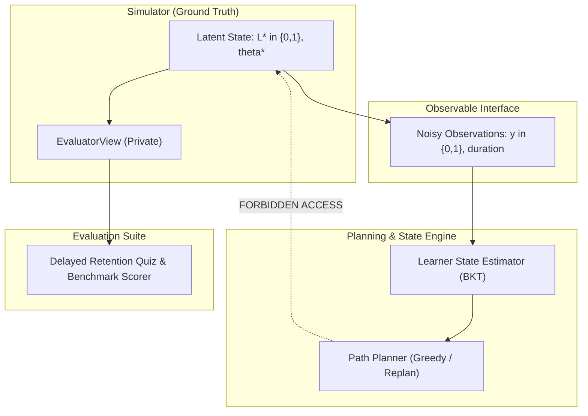

# Formal Evaluation Protocol

This document establishes the official empirical evaluation protocol for the Adaptive Learning and Path-Planning Engine. It defines the predeclared evaluation metrics, benchmark baselines, operational definition of the independent retained-recall outcome, paired bootstrap confidence intervals, matched and mismatched simulator families, and the latent state invisibility invariant.

---

## 1. Predeclared Metrics

All evaluation runs must report the following predeclared metrics across matched evaluation seeds:

### 1.1 Strict Correctness Invariants (Hard Gates)
These metrics evaluate non-negotiable correctness properties. Any run violating these constraints constitutes an immediate failure:
1. **Prerequisite-Violation Count:**
   $$\sum_{t=1}^T \sum_{i \in \text{Plan}_t} \mathbb{I}\left(\exists p \in \text{Pred}(i) : p \notin \text{Mastered}_{t-1}\right) = 0$$
   *Mandatory Target:* **0.0** (Strictly zero violations allowed).
2. **Daily-Budget Violation Count:**
   $$\sum_{t=1}^T \mathbb{I}\left(\sum_{i \in \text{Plan}_t} \text{duration}(i) > B\right) = 0$$
   *Mandatory Target:* **0.0** (Strictly zero daily budget overruns allowed).
3. **Trace Explanation Coverage:**
   $$\text{Coverage} = \frac{|\text{Documented Candidates in Trace}|}{|\text{Candidate Universe}|} = 1.0$$
   *Mandatory Target:* **1.0** (100% of candidate nodes documented with valid reason codes).

### 1.2 Primary Educational Outcome
4. **Independent Retained-Recall Rate ($\text{RR}_{D}$):**
   The proportion of correctly answered questions on an unannounced delayed quiz administered $D$ days post-intervention, evaluated strictly from ground-truth latent state by the evaluator.

### 1.3 Planning Efficiency & Optimization Quality
5. **Plan Feasibility Rate:**
   Percentage of planning instances resolved to `FEASIBLE` status versus `INFEASIBLE_PROVED` or `HEURISTIC_NO_PLAN`.
6. **Greedy-to-Optimal Score Ratio ($\bar{\rho}$):**
   $$\bar{\rho} = \frac{1}{M} \sum_{m=1}^M \frac{\text{Score}_{\text{greedy}}(m)}{\text{Score}_{\text{oracle}}(m)}$$
   Evaluated against the exact exhaustive search oracle across the 250-instance benchmark set (acceptance target: $\bar{\rho} \ge 0.95$, with 5th percentile and minimum reported).
7. **Learning Efficiency (Time-to-Mastery):**
   Total study time (in minutes) and total curriculum days required to bring all target concepts to true mastery.
8. **Algorithmic Planning Runtime:**
   Execution wall-clock time per daily planning cycle (in milliseconds).

---

## 2. Benchmark Baselines

The proposed adaptive learning engine is compared against two standardized control baselines:

### Baseline 1: Static Prerequisite Order (`src/planning/static_baseline.py`)
- **Mechanism:** Constructs a fixed topological ordering of the curriculum DAG from foundational root nodes to the target goal.
- **Scheduling Policy:** Greedily packs lessons in topological sequence each day up to the daily budget $B$, preserving block indivisibility.
- **Non-Adaptivity:** Completely ignores real-time learner response outcomes, diagnostic ability estimates, review urgency, and forgetting dynamics. If a learner struggles or misses sessions, the schedule does not remediate or adapt.

### Baseline 2: Non-Adaptive Greedy (`src/planning/greedy.py` without State Updating)
- **Mechanism:** Selects eligible tasks from the immediate planning frontier using static priority scores (such as static base difficulty or curriculum depth) divided by task duration (Score-Per-Minute).
- **Scheduling Policy:** Greedily packs the highest-priority tasks into daily budgets.
- **Non-Adaptivity:** Does not update mastery probabilities ($p_{c,t}$ remains static), does not estimate belief variance $\sigma^2$, and never schedules spaced reviews or dynamic remediation.

---

## 3. Independent Retained-Recall Outcome (Operational Definition)

To avoid circular self-evaluation (where a planner is rewarded merely for maximizing its own internal state estimates), retention is defined operationally as an independent post-intervention measurement:

### Operational Definition
1. **Target Selection:** For each concept $c$ in the learner's completed curriculum path, the evaluator constructs an independent evaluation set.
2. **Item Count ($N$):**
   - The delayed quiz administers exactly **$N = 5$ items per concept** `[PROPOSED]`.
3. **Delay Horizon ($D$):**
   - The delayed quiz is administered exactly **$D = 7$ days** after the learner's final study interaction on that concept `[PROPOSED]`.
4. **Scoring Mechanism:**
   - Responses are scored directly by the simulator's `EvaluatorView` based on the true latent cognitive state:
     $$y_{i, c} \sim \operatorname{Bernoulli}\left(P(\text{Correct} \mid L^*_c, \Delta t = D)\right)$$
   - The planner's internal BKT mastery estimates ($p_{c,t}$) and HLR predicted recall ($R_{c,t}$) play **no role** in computing the outcome score.

*Proposal Summary for Mentor Confirmation:*
- **$N$ (items per concept):** **5 items** `[PROPOSED]`
- **$D$ (delay before retention quiz):** **7 days** `[PROPOSED]`

---

## 4. Statistical Rigor & Paired Bootstrap Confidence Intervals

To test whether the adaptive planner achieves statistically significant gains over the baselines without relying on invalid normality assumptions, the protocol mandates paired bootstrap resampling:

1. **Paired Learner Instances:** Each policy is evaluated on identical initial learner profiles, identical curriculum DAGs, identical daily budgets, and identical random seed draws for stochastic response generation.
2. **Metric Differential:** For each paired learner instance $k$, the performance difference is:
   $$\Delta_k = \text{Metric}_{\text{Adaptive}}(k) - \text{Metric}_{\text{Baseline}}(k)$$
3. **Bootstrap Resampling:**
   - Sample $K$ learner instances with replacement from the evaluation cohort.
   - Compute mean differential $\bar{\Delta}^*$.
   - Repeat for **$B = 1000$ bootstrap resamples** `[PROPOSED]`.
4. **95% Confidence Interval:**
   The two-sided 95% bootstrap confidence interval is computed via the empirical percentile method:
   $$\text{CI}_{0.95} = \left[\hat{q}_{0.025}, \hat{q}_{0.975}\right]$$
   Statistical superiority is declared if and only if the lower bound $\hat{q}_{0.025} > 0$.

*Proposal Summary for Mentor Confirmation:*
- **$B$ (bootstrap resamples):** **1000 resamples** `[PROPOSED]`

---

## 5. Matched and Mismatched Simulator Families

To prevent circular evaluation and establish algorithmic robustness under model misspecification, evaluation must execute across two distinct simulator families:

### Family A: Matched Simulator (`MatchedBKTGenerator`)
- **Generative Process:** Synthetic learners follow standard 4-parameter BKT dynamics matching the engine's internal modeling assumptions ($p_{init}=0.10, p_{transit}=0.15, p_{slip}=0.10, p_{guess}=0.20$).
- **Purpose:** Verifies that the planner achieves near-optimal learning efficiency under ideal, well-specified conditions.

### Family B: Mismatched Simulator (`MismatchedPFAOrLogisticGenerator`)
- **Generative Process:** Synthetic learners follow non-BKT cognitive dynamics:
  - Multi-practice learning curves driven by Performance Factors Analysis (PFA: $\operatorname{logit}(p) = \beta + \gamma \cdot \text{successes} + \rho \cdot \text{failures}$).
  - Continuous power-law or exponential forgetting curves ($R = (1 + \alpha t)^{-\beta}$).
  - Stochastic learner fatigue, slip degradation over long study sessions, and unannounced missed study days.
- **Purpose:** Tests whether the adaptive engine remains robust, stable, and advantageous even when its internal BKT/HLR modeling assumptions diverge from real student response realities.

---

## 6. Latent State Invisibility Invariant

A fundamental architectural boundary is enforced between the simulator and the planner:

### Invariant Rules
1. **Encapsulation:** True latent cognitive mastery ($L^* \in \{0, 1\}$ or $\theta^*$) is private to `SimulatedLearner` and accessible exclusively through `EvaluatorView`.
2. **Observable-Only Input:** The planning engine (`src/planning/`) and learner state tracker (`src/state/`) observe strictly discrete, noisy student responses ($y \in \{0, 1\}$) and elapsed response times.
3. **Zero Imports Invariant:**
   - No module in `src/planning/` or `src/state/` may import `EvaluatorView`.
   - No module in `src/planning/` or `src/state/` may read or write latent variables.
4. **Automated Verification:** Verified continuously via automated AST / import analysis in `tests/test_simulation.py::test_planner_and_state_modules_contain_no_import_of_evaluator_view`.

---

## 7. Acceptance Groups & Protocol Implementation Status (Week 4 Reconciliation)

The current implementation status of each evaluation and acceptance group across modules M1–M8 is summarized below with Week 4 evidence:

| Acceptance Group | Scope & Invariant | Current Status | Week 4 Implementation & Verification |
|---|---|---|---|
| **M1-a to M1-d** | Curriculum DAG validation, BKT numerical parity with `pyBKT 1.4.3`, variance/window classification, zero prerequisite violations | `passing` | Verified in unit and acceptance suites; zero prerequisite violations strictly enforced. |
| **M2-a, M2-b** | Adaptive Diagnostic Policy (CAT/IRT): Maximum Fisher Information item selection, stopping rule ($\operatorname{Var} \le 0.15$ or 10 items), ability-to-prior mapping via logistic link | `passing` | Verified against synthetic item bank (`data/processed/item_bank_synthetic.csv`) and Q-matrix in `tests/test_m2_adaptive_diagnostic.py` and `tests/test_w4_b3_diagnostic.py`. |
| **M3-a to M3-c** | Zero daily budget overruns, 250-instance greedy benchmark vs. exact oracle ($\bar{\rho} \ge 0.95$, 12/18 counterexample), order-invariant exhaustive oracle | `passing` | Zero budget violations strictly enforced; benchmark reports $\bar{\rho} = 0.9737$. |
| **M4-a** | Infeasibility Detection & Repair Guidance: Partition into `FEASIBLE`, `INFEASIBLE_PROVED`, `HEURISTIC_NO_PLAN` | `partial` | **Partial (mentor confirmed).** Strict mathematical infeasibility proves single-block ($> B$) and capacity ($> DB$) violations with actionable repairs; heuristic packing dead-ends return `HEURISTIC_NO_PLAN` without dynamic constraint relaxation. |
| **M4-b** | 2-Up / 1-Down Dynamic Exercise Adaptation: Step $\pm 0.10$ bounded in $[0.05, 0.95]$ | `passing` | Implemented in `src/planning/difficulty.py` using `config/adaptive.yaml`; verified in `tests/test_m4_difficulty_adaptation.py` and `tests/test_w4_a3_difficulty_gate.py`. |
| **M5-a** | Remediation Trigger on Repeated Assessment Failure | `passing` | Implemented in `src/planning/replan.py`; repeated failures trigger lowest-mastery unmet prerequisite scheduling inside budget. |
| **M5-b** | HLR Spaced Review Scheduling: Exponential recall decay $R_c = 2^{-\Delta t / 14.0} < 0.85$ | `passing` | Implemented in `src/planning/replan.py` via `ReviewLog`; verified in `tests/test_m5_spaced_review_remediation.py` and `tests/test_w4_a4_review_remediation.py`. |
| **M6-a, M6-b** | Dynamic Event Replanning: External events preserve completed progress; budget reduction produces compressed plan or capacity infeasibility | `passing` | Implemented in `src/planning/replan.py`; verified in `tests/test_m6_replanning_events.py` and `tests/test_m6_dynamic_replanning.py`. |
| **M7-a, M7-b** | Explainability Framework: 100% candidate universe coverage per day, 8 schema fields, valid reason codes | `passing` | Verified in `tests/test_m7_explainability.py` and `tests/test_m7_trace_contract.py`. |
| **M8-a** | Learner Profile Plan Differentiation | `partial` | **Partial (mentor confirmed).** Multi-profile differentiation verified in `tests/test_w4_b2_provenance_profiles.py` and `tests/test_w4_t2_slice.py`; legacy stub `tests/test_m8_evaluation.py::test_tc_8_1` remains skipped. |
| **M8-b** | Single Runnable End-to-End Command | `passing` | **Passing.** The standalone CLI exists now in `src/cli.py` with `demo`, `plan`, and `slice` subcommands. Full verification runs via `scripts/clean_run.ps1` with exit code 0. |
| **M8-c** | Latent Mastery Simulator Invisibility Invariant | `passing` | AST analysis confirms zero imports or reads of `EvaluatorView` in `src/planning/` and `src/state/`. |
| **M8-d** | Independent Retained-Recall Outcome Evaluation | `partial` | **Partial (mentor confirmed).** Multi-arm comparative evaluation across diagnostic arms (Random, Static, CAT) and planner arms (Static, Greedy, Adaptive) is executed in `src/evaluation/compare.py`, while delayed retention quiz under `MismatchedPFAOrLogisticGenerator` remains deferred. |

